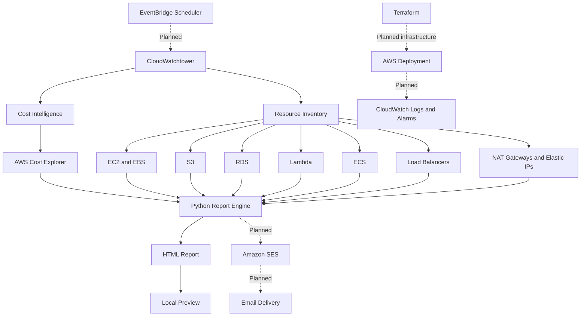

# CloudWatchtower
**AWS Cost Intelligence and Resource Monitoring Platform**
- CloudWatchtower is a Python-based AWS monitoring platform designed to improve cloud cost visibility, resource inventory, and security awareness. It uses Boto3 to collect AWS resource metadata and Cost Explorer data, then generates consolidated reports for operational and architectural decision-making.
The project is being developed as a low-cost, security-first AWS engineering solution using Python, AWS-native services, and Terraform.

## Architecture



## Current Features
- Cost monitoring:Retrieves daily AWS costs grouped by service and calculates month-to-date spending through AWS Cost Explorer.
- EC2 inventory: Collects instance identifiers, states, instance types, IP addresses, and availability zones.
- S3 inventory:Reports bucket names, regions, versioning, and encryption configuration.
- RDS inventory: Collects database status, engine, storage, encryption, and accessibility metadata.
- Lambda inventory: Reports function runtimes, memory, timeout settings, and state information.
- EBS inventory: Collects volume sizes, types, encryption status, and attachment information.
- ECS inventory: Collects cluster, task, and service information.
- Load balancer inventory: Reports load balancer types, schemes, states, and associated VPCs.
- Network resource inventory: Collects NAT Gateway and Elastic IP information.
- HTML reporting: Consolidates cost and resource information into a single report.

## Technology Stack

| Component | Technology |
|---|---|
| Language | Python |
| AWS SDK | Boto3 |
| Cost data | AWS Cost Explorer |
| Compute and storage inventory | EC2, EBS, S3, Lambda |
| Database inventory | Amazon RDS |
| Container inventory | Amazon ECS |
| Networking inventory | ELB, NAT Gateway, Elastic IP |
| Reporting | Python, HTML |
| Infrastructure as Code | Terraform — planned |
| Scheduling and notifications | EventBridge Scheduler and SES — planned |
| Monitoring and logging | Amazon CloudWatch — planned |

## Project Structure

```text
cloudwatchtower/
├── src/
│   ├── collectors/
│   │   ├── ec2.py
│   │   ├── rds.py
│   │   ├── s3.py
│   │   ├── lambda_functions.py
│   │   ├── ebs.py
│   │   ├── ecs.py
│   │   ├── elb.py
│   │   ├── nat_gateway.py
│   │   └── elastic_ips.py
│   ├── cost/
│   │   └── cost_explorer.py
│   ├── report.py
│   ├── email_report.py
│   ├── preview_report.py
│   └── handler.py
├── tests/
├── infrastructure/
├── requirements.txt
├── .gitignore
└── README.md
```

## Getting Started

### Prerequisites

- Python 3.11 or later, compatible with the installed dependencies
- An AWS account
- AWS CLI configured with an appropriate profile
- IAM permissions for the read-only inventory and Cost Explorer operations

### Installation

Clone the repository:

```bash
git clone https://github.com/Copubah/cloudwatchtower.git
cd cloudwatchtower
```

Create and activate a virtual environment:

```bash
python3 -m venv .venv
source .venv/bin/activate
```

Install dependencies:

```bash
pip install -r requirements.txt
```

Configure AWS credentials using an AWS CLI profile or an appropriate IAM role. Avoid placing access keys directly in source code.

Verify the AWS identity:

```bash
aws sts get-caller-identity
```

### Run the Collectors

Retrieve AWS cost data:

```bash
python -m src.cost.cost_explorer
```

Inventory S3 buckets:

```bash
python -m src.collectors.s3
```

Run the combined inventory report:

```bash
python -m src.report
```

Generate the HTML preview:

```bash
python -m src.preview_report
```

Run the tests:

```bash
python -m pytest
```

Run only the commands supported by the current implementation; email delivery and scheduled execution require additional configuration.

## Security Design

CloudWatchtower follows these principles:

- Read-only resource discovery wherever possible.
- Least-privilege IAM permissions.
- No automatic resource deletion or shutdown.
- No hardcoded AWS credentials.
- Environment-based configuration where appropriate.
- Automated tests using mocked AWS responses.
- Infrastructure deployment through reviewed Terraform configurations.

The reporting tool is intended to identify information for investigation, not to make destructive changes to an AWS account.

## Roadmap

- [x] AWS Cost Explorer integration
- [x] EC2, S3, RDS, Lambda, EBS, and ECS inventory
- [x] Load balancer, NAT Gateway, and Elastic IP inventory
- [x] Consolidated report generation
- [ ] Fix and test cost and S3 HTML rendering
- [ ] Add VPC inventory
- [ ] Add CloudWatch monitoring metadata and alarms
- [ ] Add IAM inventory and security findings
- [ ] Implement and test SES email delivery
- [ ] Schedule daily reports using EventBridge Scheduler
- [ ] Add structured logging, retries, and dead-letter handling
- [ ] Deploy infrastructure using Terraform
- [ ] Expand unit and integration test coverage
- [ ] Add cost safeguards and deployment documentation

## Cost Considerations

The project is designed to minimize additional AWS spending. Cost Explorer and inventory API calls may have different pricing implications, and deployed resources such as Lambda functions, logs, queues, and email infrastructure may incur charges. Review AWS pricing and configure budget alerts before deployment.

## Author

**Charles Opuba**

- GitHub: [@Copubah](https://github.com/Copubah)

## License


